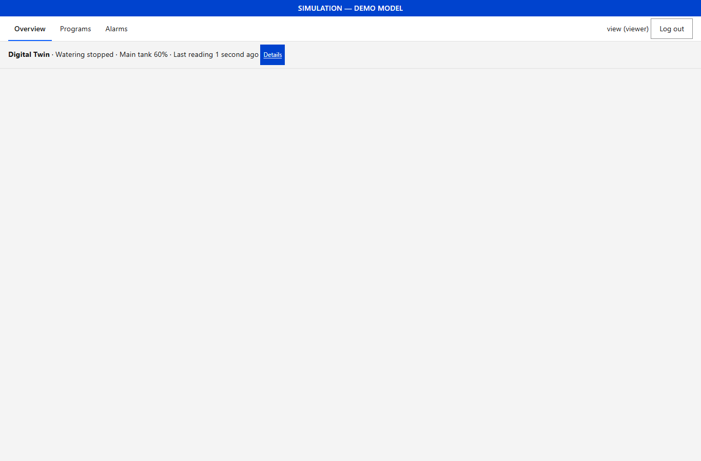
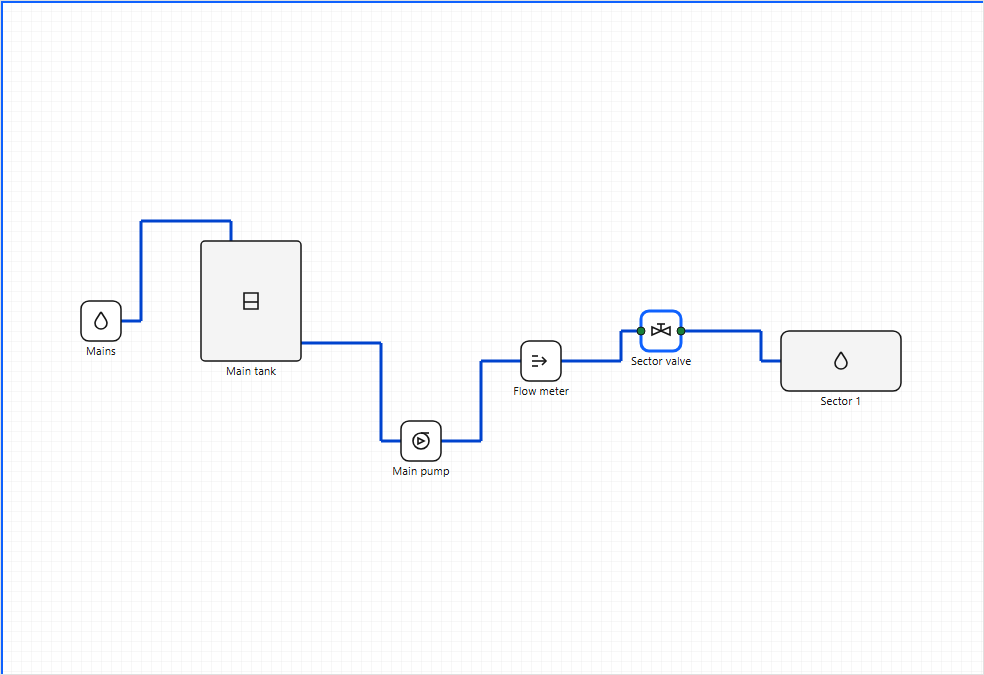
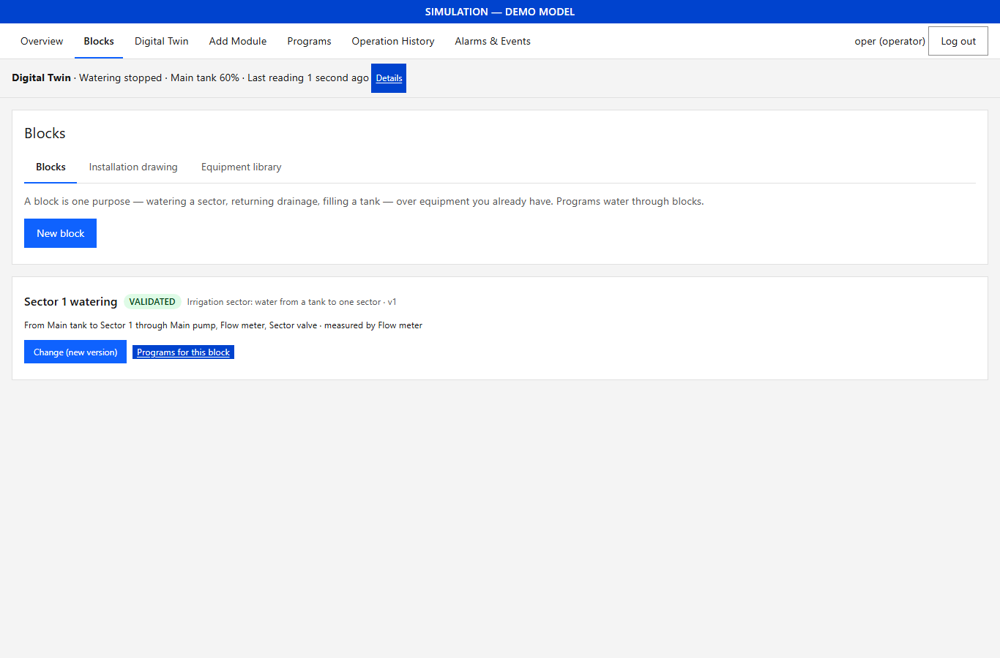
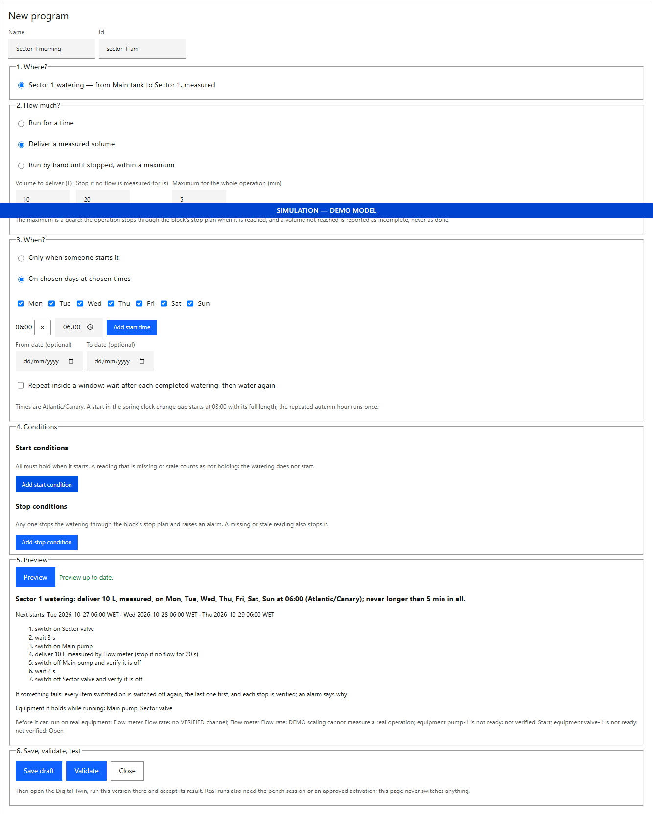
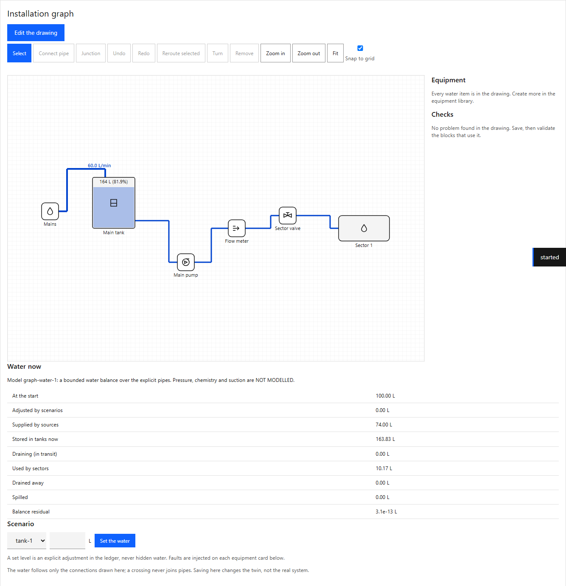
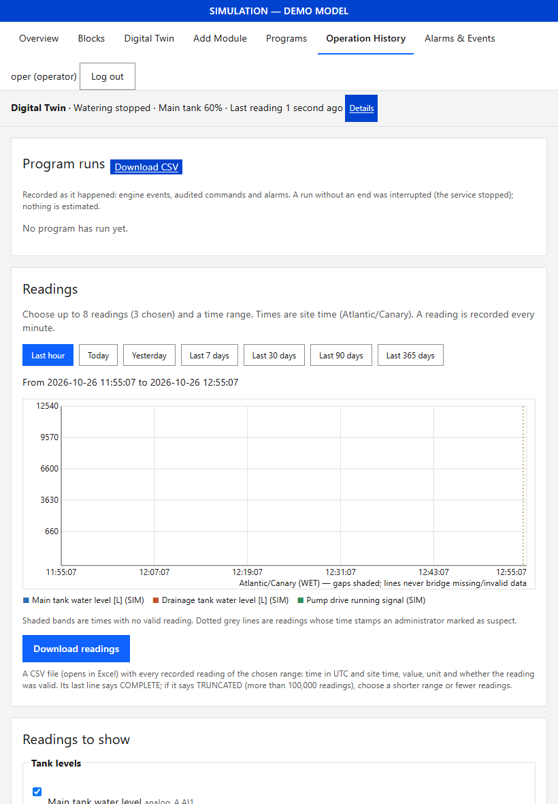

# AquaCrop 0.7.0 walkthrough: from equipment to a tested watering program

A plain-language tour of the operator journey, with screenshots taken from the 0.7.0 build on a desktop PC in the
simulated installation (no hardware connected). Every number in it is a DEMO value for the tour, not an installation
value. Owner acceptance is yours to give: nothing here is a physical result.

## 1. What each account sees

* **Operator**: Overview, Blocks, Digital Twin, Add Module, Programs, Operation History, Alarms & Events.
* **Viewer**: Overview, Programs, Alarms. A viewer cannot open the twin, history or equipment.
* **Administrator**: everything, plus Equipment, the hardware pages and Settings.

A viewer who follows an old link to another page is told which role it needs:

## 2. Equipment with forms

Blocks → Equipment library. Choose a type, a name and an id, then Create. Open "Details of …" to fill in the
properties (a tank's capacity, a pump's rated flow), the scaling of a measurement and its alarm limits, all as fields
with units. "Where the numbers come from" records their provenance (DEMO here). Save makes a new version of the item;
the result is written beside the button.

A channel can be proposed by any operator ("Set"); verifying it with the device connected needs the commissioning flag.

## 3. The installation drawing

Blocks → Installation drawing. Place each item from the Equipment list, then choose **Connect pipe**: an outlet,
then the inlet it feeds. The pipe is routed with horizontal and vertical segments only. Drag a symbol (or select it and
use the arrow keys): its pipes follow, still square. Select a pipe and drag a square handle (or arrow keys) to move one
segment; the router keeps that choice until **Reroute selected**. Two pipes that cross show a small gap and are not
connected; **Junction** makes a deliberate connection, shown as a dot. Save writes the connections and the drawing
together; moving things changes the drawing only, never the connections.

## 4. A block

Blocks → New block: choose the purpose, where the water comes from and where it goes, then "Find the path and an
example plan". The path follows the drawn connections; the plan (open the valve, wait, start the pump; stop the reverse
way) is an example to check and edit. "Wait for its feedback" needs a feedback channel on that item (a running signal,
an open switch); untick it where there is none, or the program form will ask you to. Save draft, then Validate.

## 5. A program, without code

Programs → New program: (1) the block, (2) how much (time, a measured volume, or by hand within a maximum), (3) when
(days and start times, an optional date range, an optional repeat inside a window), (4) start and stop conditions,
(5) Preview, which shows exactly the steps the engine will run, what it holds, and what a real run would still need,
(6) Save and Validate. A problem is written beside the button with what to change.

## 6. Test it in the digital twin

Open the Digital Twin from the real dashboard (same login). The twin imports the equipment, drawing, block and program.
Activate the program, approve the restart checklist into MANUAL, Run now, Run. The installation graph shows the
simulated flow on each pipe and the water in each tank; the ledger shows where every litre went. Inject a fault on an
equipment card (for example NO_FLOW on the pump) and run again: the program stops and says why. Accept the result to
record it on the real system for exactly this version.

## 7. Look back

Operation History → Program runs: each run with its result and volume; "Timeline" shows the recorded steps, commands
and alarms; "Download CSV" exports them. A run in the twin is in the twin's own Operation History, never in the real
system's.

On a tablet (820 px wide here) the menu wraps and no page scrolls sideways:

## How these screenshots were made

`python scripts/ui_check/run_journey_070.py --out <folder>` starts a throwaway real service (installation-48,
simulated) and twin on 127.0.0.1, creates an administrator, an operator and a viewer, and drives headless Chromium
through this tour with real mouse gestures (drags with intermediate moves), clicks, typing and the arrow keys. Each
result is read back through the API; `walkthrough-0.7/checks.json` is the run that made these images (29 checks
passed, 0 failed). It is browser evidence in simulation only.

## What this tour does not show

No real equipment was switched. Physical bench tests keep the 0.5 path (IO 8CH test loads, an armed lease, accepted
twin evidence). Pressure, chemistry and pump suction are NOT MODELLED in the twin.
